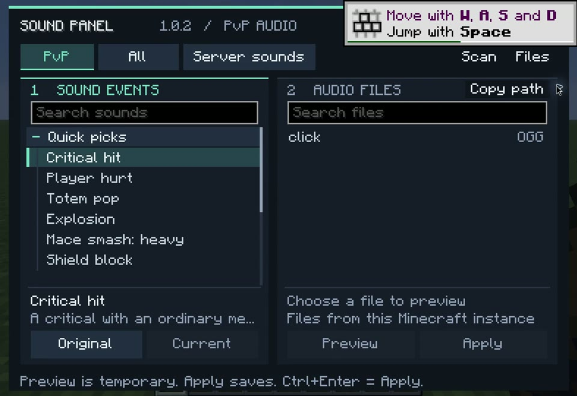
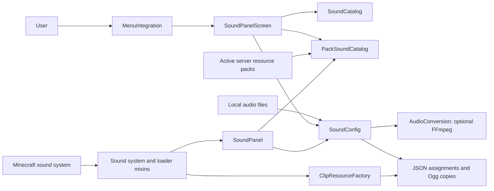

<div align="center">
<h1>Sound Panel</h1>
<hr>
<p><strong>3 sound catalogs in one place: PvP events, all sounds, active server-pack sounds</strong></p>
<p>


</p>
<p>
<a href="https://github.com/hhhhhffd/SoundPanel/releases/latest"></a>
<a href="https://github.com/hhhhhffd/SoundPanel/releases"></a>
<a href="LICENSE"></a>
</p>
<p><a href="https://github.com/hhhhhffd/SoundPanel/releases/latest">Download</a> · <a href="#demo">Demo</a> · <a href="#architecture">Architecture</a> · <a href="#build">Build</a></p>
</div>

## Demo

[](https://github.com/hhhhhffd/SoundPanel/releases/download/v1.0.2/Sound-Panel-1.0.2-Crit-Demo.mp4)

[Watch or download the MP4 with audio](https://github.com/hhhhhffd/SoundPanel/releases/download/v1.0.2/Sound-Panel-1.0.2-Crit-Demo.mp4).

## Executive Summary

Sound Panel is a client-side Fabric mod for Minecraft Java 1.21.11 that replaces individual sound events with local audio. Its panel separates event selection, auditioning, and explicit application; validated playback copies keep assignments independent of the original files. No server mod is required.

## Technical Stack

| Area | Technology | Version or role |
| --- | --- | --- |
| Core | Minecraft Java, Java | 1.21.11, Java 21 or newer |
| Core | Fabric Loader, Fabric API, Mod Menu | Loader 0.18.4+, Fabric API required, Mod Menu 17.0.0+ |
| Build | Fabric Loom, Yarn | 1.14.10; 1.21.11+build.4 mappings |
| Build | Gradle wrapper | 9.2.1 |
| Data | Local JSON and Ogg Vorbis | Assignments and validated playback copies in the instance config directory |
| Optional | FFmpeg with libvorbis | Local conversion of other audio formats |

The build uses Fabric API `0.141.3+1.21.11` and Mod Menu `17.0.0`.

## Architecture



### Design choices

- **Explicit persistence:** `SoundPanelScreen` prepares a scratch preview through `SoundConfig`; Apply installs a validated copy and saves the assignment. Auditioning alone does not change it.
- **Server-pack provenance:** `PackSoundCatalog` indexes active server resources, including detected file-only overrides. Server assignments are keyed by server address and checked against the active catalog during playback.
- **Local playback resources:** sound loader and sound system mixins connect Minecraft playback to `SoundPanel` and `ClipResourceFactory`, using stored Ogg copies rather than relying on the original file remaining in place.

## Project Structure

```text
.
├── README.md                 # Usage and architecture
├── LICENSE                   # MIT license
├── build.gradle              # Dependencies and build configuration
├── gradle.properties         # Gradle runtime settings
├── settings.gradle           # Gradle project settings
├── gradle/wrapper/           # Gradle wrapper configuration and JAR
├── gradlew, gradlew.bat      # Gradle wrapper launchers
├── docs/media/               # Demo thumbnail
└── src/
    ├── main/                 # Client implementation, mixins and Fabric metadata
    └── test/                 # Existing focused checks and audio fixture
```

## Installation and Usage

1. Install Minecraft Java **1.21.11** with **Java 21**, Fabric Loader **0.18.4 or newer**, Fabric API, and **Mod Menu 17.0.0 or newer**. Place the [release JAR](https://github.com/hhhhhffd/SoundPanel/releases/latest), Fabric API, and Mod Menu in that instance's `mods` directory.
2. Put audio files in the instance's `sounds` folder. For the normal launcher profile this is `.minecraft/sounds`; other launcher instances have their own game directory. Sound Panel creates the folder on first launch.
3. Open **Mods → Sound Panel → Configure**. **PvP** starts with common melee, crystal, survival, mace, shield, and XP sounds; **All** contains the full expandable sound catalog. Search the event list on the left and the audio file list on the right separately.
4. Select an event and a file. **Original** plays vanilla or the raw pack event; **Current** plays the installed replacement; **Preview** auditions the selected file. Only **Apply** saves a new replacement. **Reset** restores the original without removing the source file.
5. **Files** asks the system file manager to open the instance's sound folder. If no window appears, use **Copy path** and paste it into your file manager; hover over it to see the exact path. **Scan** refreshes the file list. You can drop one supported file onto the panel.

Arrow keys move through the focused list; Enter auditions the selected file, and Ctrl+Enter (Cmd+Enter on Mac) applies it. The selected file stays selected when changing events, so it can be reused. Scratch previews are discarded when changing files or leaving the panel.

Regular PvP and All assignments apply client-side in single-player and multiplayer. **Server sounds** lists sounds declared by active server resource packs, including detected file-only overrides; normal local packs are excluded. Enable or download a server pack through Minecraft: Sound Panel does not download or scan inactive packs.

A Server sounds assignment is stored separately for the current server address and applies only while its sound is present in an active server pack. Without an assignment, the server's original sound plays.

### Bottle o' Enchanting

- **Throw** has its own replacement.
- **Shatter** uses the splash packet and nearby tracked projectiles to distinguish a bottle impact from an ordinary potion. If the bottle is not tracked, the event is ambiguous, or the server changes its protocol, Minecraft plays the ordinary sound instead.
- **XP pickup** replaces the experience-orb pickup sound for all XP sources, including mob drops, because vanilla shares that sound.

## Audio Formats and Configuration

| Input | Requirements and limits |
| --- | --- |
| Ogg Vorbis (`.ogg`, `.oga`) | Native; mono or stereo, up to 24 MB |
| MP3, WAV, FLAC, AAC/M4A, Opus, AIFF, WMA, and audio tracks from MP4/WebM | Optional FFmpeg with libvorbis on Minecraft's `PATH`; input up to 64 MB, output up to 10 minutes or 24 MB. Converted to mono for directional playback. |

> [!NOTE]
> The mod neither installs FFmpeg nor uploads audio. Restart Minecraft after installing FFmpeg so it can find the executable on its `PATH`.

| Instance path | Purpose |
| --- | --- |
| `sounds/` | Source audio files |
| `config/soundpanel/sounds.json` | Saved assignments |
| `config/soundpanel/clips/` | Validated playback copies |
| `config/soundpanel/preview/` | Temporary scratch previews |

Moving a source file does not break a saved replacement. Resetting an action removes neither the source nor its playback copy; removing the corresponding playback copy causes the original sound to be used.

## Build

Use a **full JDK 21** installation and run from the project root:

```sh
./gradlew build
```

The build includes focused checks for curated PvP sound IDs, compact and wide panel geometry, temporary previews, Bottle impact context, real Ogg Vorbis import, independent assignments, server provenance, and persistence.

## Deliverables and Links

- [Latest release and downloads](https://github.com/hhhhhffd/SoundPanel/releases/latest): mod JAR, source archive, and demo MP4.
- [Demo MP4 with audio](https://github.com/hhhhhffd/SoundPanel/releases/download/v1.0.2/Sound-Panel-1.0.2-Crit-Demo.mp4).

| Version | Highlights |
| --- | --- |
| [1.0.0](https://github.com/hhhhhffd/SoundPanel/releases/tag/v1.0.0) | Initial sound catalog and separate server-sound assignments |
| [1.0.1](https://github.com/hhhhhffd/SoundPanel/releases/tag/v1.0.1) | PvP panel, previews, and explicit Apply |
| [1.0.2](https://github.com/hhhhhffd/SoundPanel/releases/tag/v1.0.2) | Folder opening fix, startup folder creation, and Copy path |

## License

[MIT](LICENSE) © 2026 hhhhhffd.
